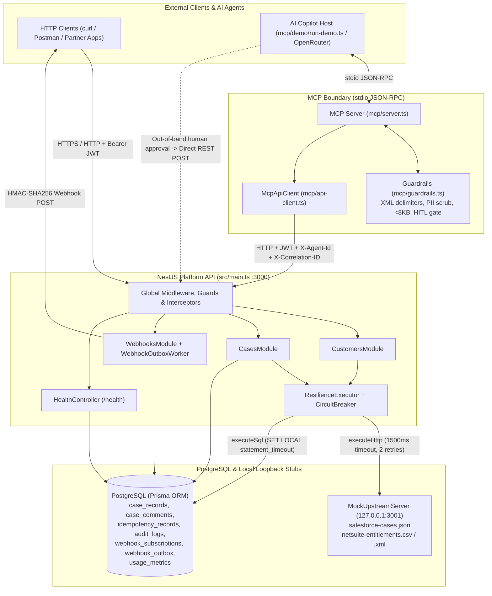
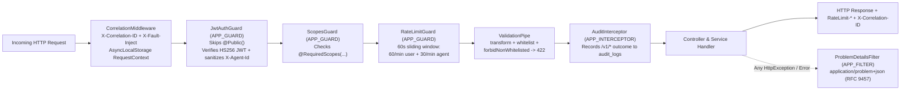
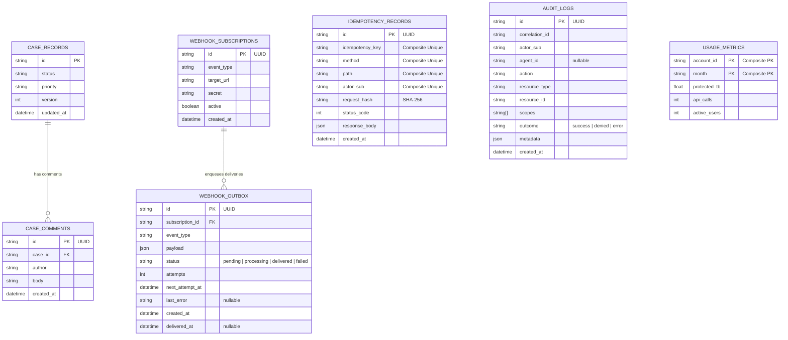
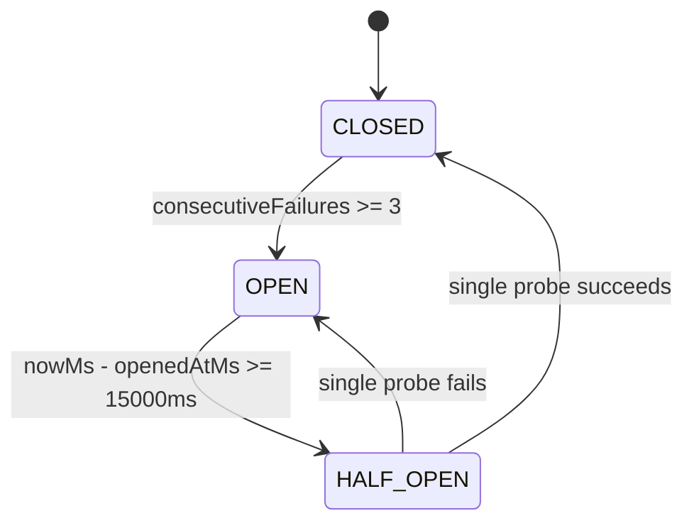
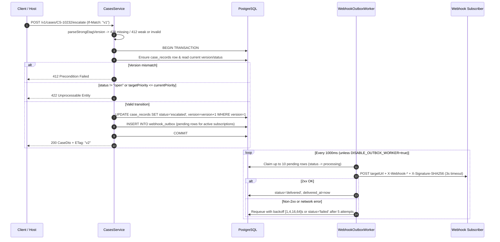
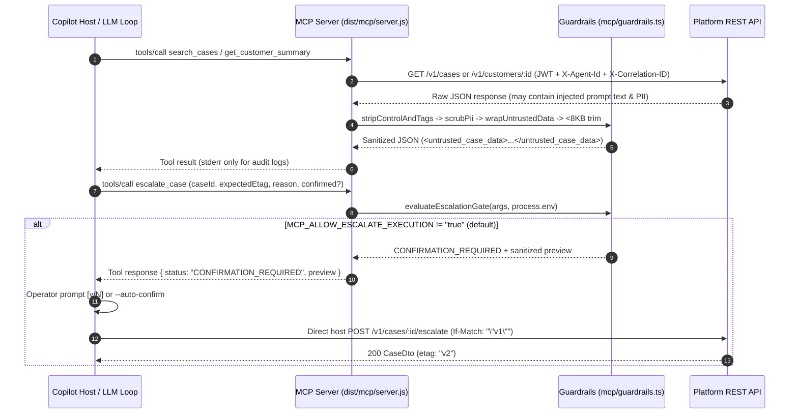

# Architecture Reference — Customer Entitlement & Support Case Platform

This document describes the implemented system architecture, runtime pipelines, data model, resilience patterns, transactional write guarantees, and MCP AI guardrail flows based directly on the codebase.

---

## 1. System Context & Container Topology



---

## 2. NestJS Request Processing Pipeline

Global bindings in [app.module.ts](../src/app.module.ts) and [main.ts](../src/main.ts) enforce cross-cutting telemetry, security, validation, and RFC 9457 error formatting on every request.



Key implementation invariants:
- `RateLimitGuard` is registered as an explicit provider and bound via `{ provide: APP_GUARD, useExisting: RateLimitGuard }` so all requests and tests share the same bucket registry.
- `CorrelationMiddleware` attaches `res.on('finish', ...)` to emit single-line structured JSON `http_request` logs via `StructuredLoggerService` including `correlationId`, `actorSub`, `agentId`, `status`, and `durationMs`.
- `NestFactory.create(AppModule, { rawBody: true })` preserves raw request bytes for constant-time HMAC signature verification (`timingSafeEqual`) on `POST /internal/webhook-receiver`.

---

## 3. PostgreSQL Data Model (Prisma ORM)

Defined in [schema.prisma](../prisma/schema.prisma) and initialized via [0001_init/migration.sql](../prisma/migrations/0001_init/migration.sql):



### Upstream Overlay Pattern
Support cases combine static fixture records from Salesforce (`MockUpstreamServer /mock/salesforce/cases`) with transactional PostgreSQL overlays in `case_records` and `case_comments`. `CasesService.mergeCaseWithOverlay` deduplicates comments by `id`, sorts chronologically, and exposes PostgreSQL `version` as `etag` (`"v1"`, `"v2"`, etc.).

---

## 4. Resilience, Fault Injection & Graceful Degradation

### Circuit Breaker Lifecycle ([circuit-breaker.ts](../src/resilience/circuit-breaker.ts))



- **Timeouts & Retries** ([resilience.executor.ts](../src/resilience/resilience.executor.ts)):
  - HTTP upstreams (`salesforce`, `netsuite`, `netsuite-xml`): `1500ms` `AbortController` timeout, `maxRetries = 2`, retryable statuses `{429, 502, 503, 504}`, backoff `150 * 2^attempt + random(0..50) ms`.
  - SQL upstream (`snowflake`): `SET LOCAL statement_timeout = 1500` inside `prisma.$transaction(...)`, `maxRetries = 2`, retryable Prisma codes `{P1001, P1008, P2024}` or PostgreSQL SQLSTATE `57014`.
  - Synthetic faults injected via `X-Fault-Inject` do not trip shared circuit breakers unless `X-Fault-Inject-Scope: circuit-breaker` is also sent (when `FAULT_INJECTION_ENABLED=true`).

### Customer Aggregation & Degradation Flow (`GET /v1/customers/:id`)

```mermaid
sequenceDiagram
  autonumber
  participant C as Client
  participant S as CustomersService
  participant U as UpstreamClientsService
  participant NS as Mock NetSuite (CSV + XML)
  participant SF as Snowflake SQL (usage_metrics)

  C->>S: GET /v1/customers/ACC-77?includeUsage=true
  S->>U: canonicalizeAccountId("ACC-77") -> "ACC-007"
  par NetSuite Primary CSV & Supplemental XML
    U->>NS: GET /mock/netsuite/entitlements.csv (resilient)
    U->>NS: GET /mock/netsuite/entitlements.xml (resilient, catches errors)
  and Snowflake Usage Telemetry (when includeUsage=true)
    U->>SF: SELECT ... FROM usage_metrics LIMIT 1 (1500ms timeout)
  end

  alt Primary CSV fails / Circuit OPEN
    U--xS: UpstreamUnavailableError
    S-->>C: 503 ProblemDetails + Retry-After: 5
  else XML fails or mismatches CSV
    U-->>S: Logs netsuite_xml_fallback_to_csv / csv_wins; returns CSV row
  end

  alt Snowflake times out / fails
    SF--xU: UpstreamUnavailableError
    U--xS: degraded = true, degradedReasons = ["usage_warehouse_unavailable"]
  end

  alt finance:read absent in JWT scopes
    S-->>C: 200 CustomerAggregate (arrUsd: null, redactedFields: ["arrUsd"])
  else finance:read present
    S-->>C: 200 CustomerAggregate (arrUsd: 480000, redactedFields: [])
  end
```

---

## 5. Idempotency, Optimistic Concurrency & Webhook Outbox

### Idempotent Comment Creation (`POST /v1/cases/:id/comments`)
1. `CasesService.addComment` validates `Idempotency-Key` (non-empty, `<= 128` chars) -> `400` if missing/invalid.
2. `computeIdempotencyRequestHash` computes SHA-256 over `POST:${path}:${actorSub}:${canonicalJson(dto)}`.
3. Inside `prisma.$transaction`: ensures `CaseRecord` overlay exists (`skipDuplicates: true`), creates `CaseComment`, and inserts `IdempotencyRecord`.
4. On concurrent or repeated key (`PrismaClientKnownRequestError P2002`): fetches the persisted `IdempotencyRecord` and compares `requestHash`. Equal hashes replay the stored `201` JSON with header `Idempotent-Replayed: true`; mismatched hashes throw `409 Conflict`.

### Optimistic Escalation & Outbox Dispatch (`POST /v1/cases/:id/escalate`)



---

## 6. MCP Server, Guardrails & Out-of-Band Human Confirmation

The MCP server ([mcp/server.ts](../mcp/server.ts)) runs as a `stdio` JSON-RPC child process rather than directly touching PostgreSQL or bypassing REST scopes.


